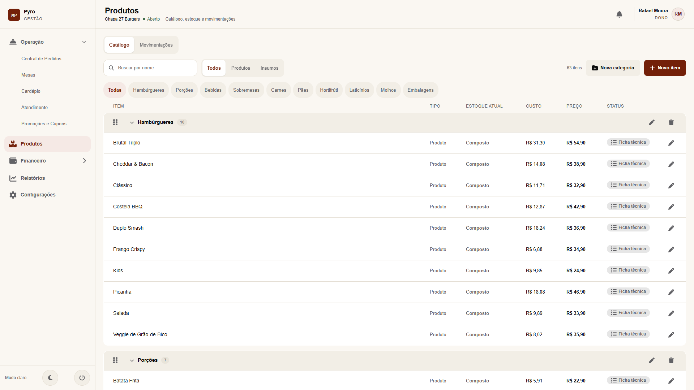
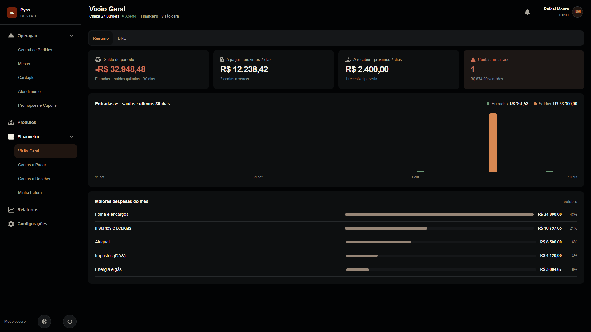
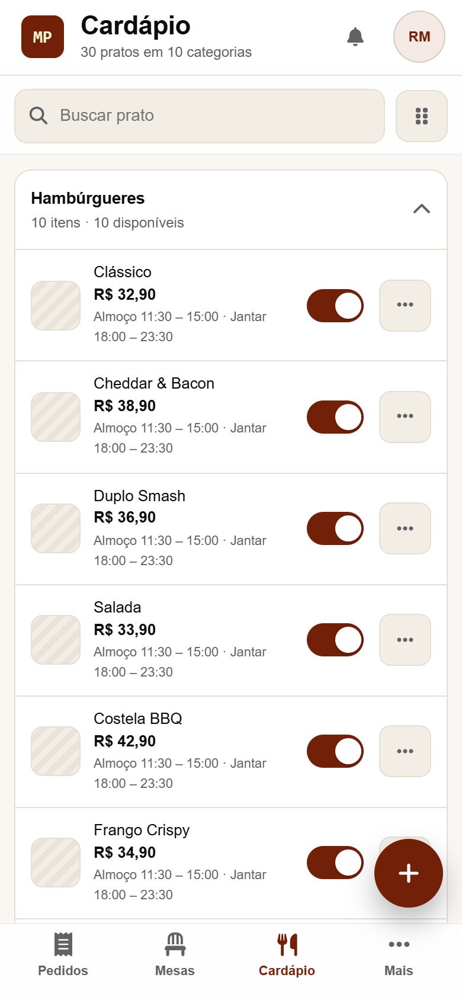
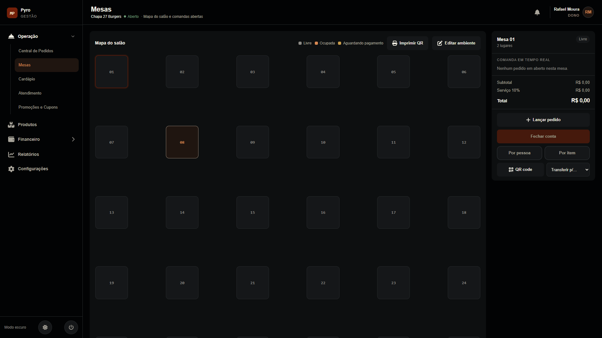
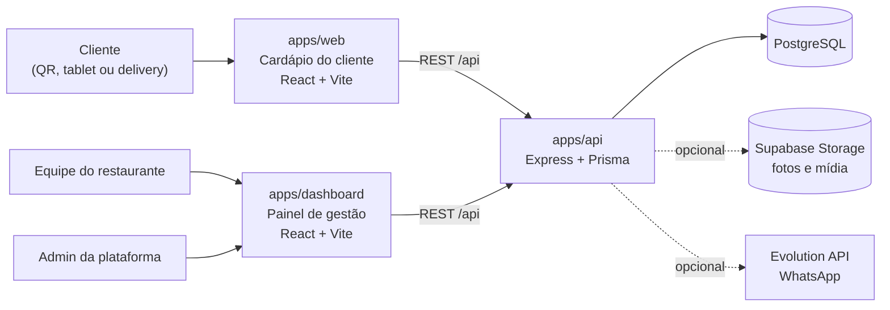
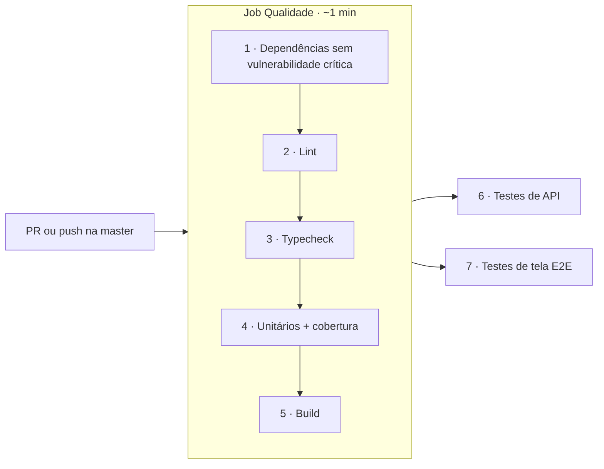

<div align="center">


# Pyro

**Gestão completa para restaurantes: cardápio digital na mesa, delivery próprio, central de pedidos, estoque e financeiro, num sistema só.**

[](https://github.com/yanmamede10/cardapio-digital/actions/workflows/qaops.yml)


[O que é](#o-que-é) · [Funcionalidades](#funcionalidades) · [Arquitetura](#arquitetura) · [Rodar no seu computador](#rodar-no-seu-computador) · [Testes e qualidade](#testes-e-qualidade-qaops) · [Documentação](#documentação)

</div>



## O que é

O Pyro é um SaaS para restaurantes pequenos e médios. O cliente escaneia o QR da mesa (ou usa um tablet fixo) e pede pelo celular, sem login e sem instalar nada. O pedido aparece na hora na Central de Pedidos da cozinha e do salão. O mesmo cardápio também atende o delivery próprio do restaurante.

Por trás do salão, o painel cuida do resto: comandas por mesa, estoque com ficha técnica, contas a pagar e a receber, relatórios e equipe com permissões por papel. Um painel de plataforma (Super Admin) cadastra os restaurantes, liga os módulos contratados e controla as mensalidades.

O repositório é um monorepo com três aplicações TypeScript (API, painel e cardápio do cliente) e um pacote compartilhado.

## Funcionalidades

### Para o cliente (cardápio digital)
- **Pedido pela mesa:** o QR ou o tablet abre o cardápio do restaurante certo, já ligado àquela mesa.
- **Opções e observações:** adicionais, tamanhos e observações em texto livre ("sem cebola").
- **Acompanhamento:** o cliente vê o status do pedido em tempo real e pode chamar o garçom.
- **Delivery próprio:** lista de restaurantes, carrinho, endereço, cupons de desconto e histórico de pedidos.

### Para o salão e a cozinha
- **Central de Pedidos:** quadro em tempo real (Recebido → Preparando → Pronto → Entregue), chamados de garçom e resumo do turno.
- **Mesas:** mapa do salão, comanda em tempo real, transferência entre mesas, taxa de serviço opcional e fechamento de conta dividido por pessoa ou por item.
- **Lançamento pelo garçom:** o garçom lança o pedido da mesa pelo celular, sem o cliente usar o QR.
- **Cardápio:** categorias, horários de almoço e jantar e disponibilidade de cada prato, com um toque.
- **Atendimento:** tickets por contato, com integração opcional ao WhatsApp.

### Para a gestão
- **Produtos e estoque:** catálogo de produtos e insumos, ficha técnica com custo, movimentações. Cada adicional pode dar baixa num insumo.
- **Financeiro:** visão geral, DRE, contas a pagar e a receber.
- **Relatórios** de vendas e operação.
- **Equipe e permissões:** quatro papéis (Dono, Administrador, Garçom e Cozinha), conferidos rota a rota na API.
- **Aparência:** cores, logo e capa da página do restaurante.

### Para a plataforma (Super Admin)
- Cadastro e ativação de restaurantes, módulos contratados por restaurante e mensalidades.

### Em todo o sistema
- Painel no computador, no celular e como app Android (Capacitor).
- Tema claro e escuro.
- Acessibilidade verificada automaticamente (WCAG 2.1 A/AA com axe-core e alvos de toque de 44 px).

**Ainda não implementado:** emissão fiscal (NF-e/NFC-e), pagamento por Pix dentro do app e impressão de pedidos. As decisões já tomadas estão nos [ADRs](docs/adr/).

<table>
  <tr>
    <td width="66%"></td>
    <td rowspan="2"></td>
  </tr>
  <tr>
    <td></td>
  </tr>
</table>

## Arquitetura



| Camada | Tecnologias |
| --- | --- |
| API | Node 22, Express, Prisma, PostgreSQL, autenticação por JWT, limites de requisição por funcionário, mesa e IP |
| Painel e cardápio | React 18, Vite, React Router, Capacitor (Android) |
| Código compartilhado | `packages/shared`: tipos, regras de dinheiro, cores e erros, importados direto do TypeScript |
| Testes | `node:test` (unitários e API), Playwright (telas), axe-core (acessibilidade), Lighthouse (carga) |
| Produção | VM com Docker Compose, Caddy (HTTPS e os dois fronts), Supabase (banco e Storage) |

```
apps/
  api/          API REST (porta 4100 em dev)
  dashboard/    Painel do restaurante e Super Admin (porta 5174)
  web/          Cardápio do cliente: mesa e delivery (porta 5173)
packages/
  shared/       Tipos e regras usados pelos três apps
tests/
  unit/         Testes unitários, sem banco
  api/          Testes de integração da API com Postgres descartável
  e2e/          Testes de tela com Playwright (desktop, tablet e celular)
  load/         Teste de carga ("casa cheia")
docs/           Guia técnico, ADRs, plano de testes, segurança e QAOps
deploy/         Docker Compose, Caddyfile e script de deploy da VM
```

## Rodar no seu computador

Este passo a passo sobe o sistema completo com dados de exemplo em uns 10 minutos. Os comandos funcionam no Windows, no macOS e no Linux; quando algo muda entre eles, o README mostra as duas versões.

### 1. Instale os pré-requisitos

| Ferramenta | Para quê | Como conferir |
| --- | --- | --- |
| [Node.js 22](https://nodejs.org/) (já vem com o npm) | Rodar os três apps | `node -v` mostra `v22.x` |
| [Docker Desktop](https://www.docker.com/products/docker-desktop/) (no Linux, o Docker Engine) | Subir o PostgreSQL sem instalar nada | `docker -v` responde e o Docker está aberto |
| [Git](https://git-scm.com/) | Baixar o código | `git --version` |

Se você já tem um PostgreSQL instalado, o Docker é opcional para rodar o sistema: veja [Problemas comuns](#problemas-comuns). Ele continua necessário para os testes de integração e de tela.

### 2. Baixe o código e instale as dependências

```sh
git clone https://github.com/yanmamede10/cardapio-digital.git
cd cardapio-digital
npm ci
```

### 3. Suba o banco de dados

```sh
docker run -d --name pyro-db -e POSTGRES_PASSWORD=pw -e POSTGRES_DB=cardapio -p 5432:5432 postgres:16-alpine
```

O banco fica rodando em segundo plano. Depois de reiniciar o computador, abra o Docker e rode `docker start pyro-db`.

### 4. Configure a API

Copie o arquivo de exemplo. Ele já aponta para o banco do passo anterior e não precisa de nenhuma chave para rodar localmente.

```sh
# macOS e Linux
cp apps/api/.env.example apps/api/.env
```

```powershell
# Windows (PowerShell)
Copy-Item apps/api/.env.example apps/api/.env
```

### 5. Prepare o banco

```sh
npm run db:generate --workspace apps/api   # gera o cliente do Prisma
npm run db:deploy   --workspace apps/api   # cria as tabelas
npm run db:seed     --workspace apps/api   # dados de exemplo: o restaurante "Fogo & Nó" e mais 5 no delivery
```

> O `db:seed` **apaga o banco** antes de criar os dados. Use só no ambiente local.

Opcional: para também ter a hamburgueria **Chapa 27 Burgers**, que aparece nas imagens deste README (30 pratos, 33 insumos com custo, estoque e financeiro do mês), rode depois:

```sh
npm run db:seed:demo --workspace apps/api
```

Ele imprime uma senha aleatória **uma única vez**. Anote, porque ela não aparece de novo.

### 6. Rode os três apps

Abra **três terminais** na pasta do projeto e rode um comando em cada:

```sh
npm run dev:api         # API em http://localhost:4100
npm run dev:dashboard   # Painel em http://localhost:5174
npm run dev:web         # Cardápio do cliente em http://localhost:5173
```

### 7. Use o sistema

**Painel do restaurante:** abra http://localhost:5174 e entre com um dos logins abaixo. Todos usam a senha `senha123`.

| E-mail | Papel | O que vê |
| --- | --- | --- |
| `marina@fogoeno.com.br` | Dono | Tudo, inclusive configurações e equipe |
| `bruno@fogoeno.com.br` | Administrador | Gestão, financeiro e relatórios |
| `paula@fogoeno.com.br` | Garçom | Central de Pedidos, Mesas, Cardápio e Atendimento |
| `igor@fogoeno.com.br` | Cozinha | Central de Pedidos, Mesas e Cardápio |

Os logins da Chapa 27 (se você rodou o seed opcional) são `dono@`, `gerente@`, `garcom@` e `cozinha@chapa27.example`, com a senha que ele imprimiu.

**Cardápio do cliente:** abra http://localhost:5173 para ver o delivery.

**Um pedido de ponta a ponta:**
1. No painel, entre como Dono e vá em **Mesas**.
2. Escolha uma mesa no mapa, clique em **QR code** e depois em **Copiar link**.
3. Cole o link numa aba anônima (ou no celular, na mesma rede). É o que o cliente veria ao escanear o QR.
4. Faça um pedido e veja ele chegar na **Central de Pedidos** do painel.
5. Avance o pedido até "Entregue" e feche a conta em **Mesas**.

### Recursos opcionais

Nada disso é necessário para rodar o sistema. Cada item está explicado no [guia técnico](docs/guia-tecnico.md):

- **Super Admin:** defina `SUPER_ADMIN_KEY` no `apps/api/.env` e abra http://localhost:5174/admin.
- **Upload de fotos e logo:** precisa de um bucket S3 (Supabase Storage). Sem ele, o upload responde que o recurso não está configurado.
- **WhatsApp no Atendimento:** sobe a Evolution API com `docker compose`.
- **App Android:** build com Capacitor e Android Studio.

### Problemas comuns

<details>
<summary><b>A porta 5432 já está em uso</b></summary>

Você provavelmente já tem um PostgreSQL instalado. Você tem duas opções:

- **Usar outra porta para o Docker:** troque `-p 5432:5432` por `-p 5433:5432` no passo 3 e, no `apps/api/.env`, troque `localhost:5432` por `localhost:5433` nas duas URLs.
- **Usar o seu PostgreSQL:** crie um banco `cardapio` e ajuste usuário e senha em `DATABASE_URL` e `DIRECT_URL` no `apps/api/.env`.
</details>

<details>
<summary><b>Erro "@prisma/client did not initialize yet" ou "Cannot find module .prisma/client"</b></summary>

Rode `npm run db:generate --workspace apps/api`. É preciso rodar de novo depois de cada `npm ci`.
</details>

<details>
<summary><b>O painel abre, mas o login falha ou não carrega nada</b></summary>

- Confira se a API está rodando no terminal dela (http://localhost:4100/api/health deve responder `{"ok":true}`).
- Confira se você rodou o `db:seed`.
- Se o banco foi recriado, rode o passo 5 de novo.
</details>

<details>
<summary><b>"Cannot connect to the Docker daemon" ou o docker run não funciona</b></summary>

Abra o Docker Desktop e espere ele terminar de iniciar antes de rodar o comando.
</details>

<details>
<summary><b>Quero apagar tudo e começar do zero</b></summary>

```sh
docker rm -f pyro-db
```

Depois repita os passos 3 e 5.
</details>

## Testes e qualidade (QAOps)

Cada pull request para a `master` passa por um pipeline no GitHub Actions com **sete quality gates**. Um gate reprovado barra os seguintes, e cada job publica relatórios como artefatos por 30 dias.



| Gate | Critério para aprovar |
| --- | --- |
| 1. Dependências | `npm audit` sem vulnerabilidade crítica nas dependências de produção |
| 2. Lint | ESLint com zero erros (e o teto de avisos atual) |
| 3. Typecheck | API, painel e cardápio sem erro de tipo |
| 4. Unitários e cobertura | Todos passam; pelo menos 80% de linhas e 70% de branches nos módulos de regra de negócio |
| 5. Build | Os três apps compilam |
| 6. API | Todos os testes de integração passam contra um Postgres descartável |
| 7. E2E | Todos os testes de tela passam (Playwright, desktop, tablet e celular) |

Para rodar os mesmos gates no seu computador:

```sh
npm run audit:deps   # gate 1
npm run lint         # gate 2
npm run typecheck    # gate 3
npm run test:unit    # gate 4 (não precisa de banco nem Docker)
npm run build        # gate 5
npm run test:api     # gate 6 (precisa do Docker)
npm run test:e2e     # gate 7 (precisa do Docker e do Google Chrome)
```

Os testes de API e de tela sobem sozinhos um Postgres descartável e a API nas portas 4200, 4299, 54329, 5273 e 5274, e derrubam tudo no fim. O seu banco local nunca é tocado.

A ficha completa de cada gate (justificativa, evidências, consequência e limitações) está em [docs/qaops/quality-gates.md](docs/qaops/quality-gates.md), e o registro do experimento aprovado → reprovado → corrigido, em [docs/qaops/experimento.md](docs/qaops/experimento.md).

## Documentação

| Documento | Conteúdo |
| --- | --- |
| [Guia técnico](docs/guia-tecnico.md) | Referência completa: variáveis de ambiente, Android, WhatsApp, testes, deploy, backup e restauração |
| [Decisões de arquitetura (ADRs)](docs/adr/) | Por que cada escolha foi feita, uma por arquivo |
| [Plano de testes](docs/testes/plano-de-testes.md) | O que é automático, o que é manual, resultados e medições |
| [Segurança](docs/seguranca/) | Matriz de permissões, checklist de deploy e auditoria |
| [Quality gates](docs/qaops/quality-gates.md) | Pipeline de qualidade e critérios de cada gate |

## Autores

- **Yan Mamede** ([@yanmamede10](https://github.com/yanmamede10)): criação e desenvolvimento do Pyro.
- **Yuri Boeira** ([@yuriboeira11tx](https://github.com/yuriboeira11tx)): pipeline de qualidade (QAOps).

O pipeline QAOps foi desenvolvido no trabalho prático de DevOps e QAOps da disciplina de Qualidade de Software do curso de Sistemas de Informação da UFSM (campus Frederico Westphalen).
