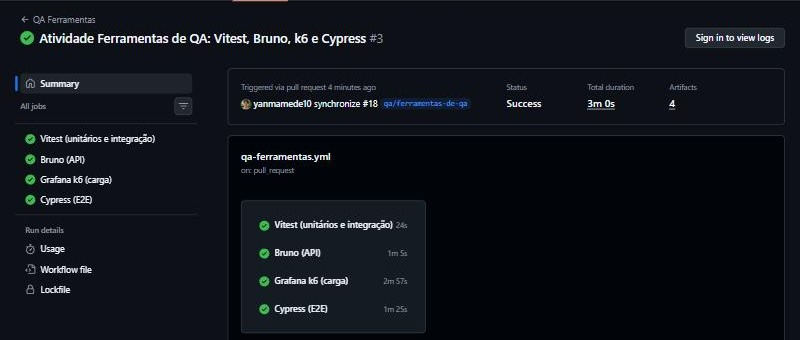
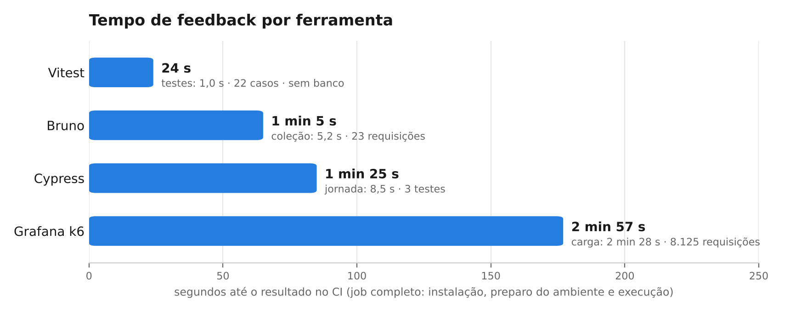

# 1. Capa e identificação

| | |
| --- | --- |
| **Universidade** | Universidade Federal de Santa Maria (UFSM), campus Frederico Westphalen |
| **Curso** | Sistemas de Informação |
| **Disciplina** | Qualidade de Software |
| **Professor** | Dr. Joel da Silva |
| **Trabalho** | Atividade prática em grupo: avaliação de ferramentas de QA, performance, automação e diagnóstico em produção |
| **Equipe** | Yan Gonçalves Mamede e Yuri Boeira |
| **Projeto** | [yanmamede10/cardapio-digital](https://github.com/yanmamede10/cardapio-digital): Pyro, SaaS de gestão para restaurantes (API Express + Prisma/PostgreSQL, app do cliente e painel em React + Vite) |
| **Entrega** | Pull request [#18](https://github.com/yanmamede10/cardapio-digital/pull/18) e este relatório (`docs/qaops/ferramentas/relatorio.md`, também em PDF) |
| **Data** | 26/11/2026 |

**Resumo.** Quatro das cinco ferramentas foram aplicadas na prática sobre o projeto (o mínimo pedido é três): **Vitest**, **Bruno**, **Grafana k6** e **Cypress**. Todas rodam num workflow próprio do GitHub Actions, o **QA Ferramentas**, sobre um banco PostgreSQL descartável com os dados de demonstração. Na execução de referência ([run 45881157465](https://github.com/yanmamede10/cardapio-digital/actions/runs/45881157465)), os quatro jobs passaram:

- **Vitest:** 22 testes em 1,0 s, com 94,8% de cobertura de linhas nos módulos testados.
- **Bruno:** 23 requisições, 27 testes e 44 asserções de status e schema.
- **k6:** 120 usuários virtuais, 8.125 requisições, 0% de erro e p95 de 4,2 ms.
- **Cypress:** a jornada do pedido pela mesa, em 3 testes e 8,5 s.

O **Google Search Console** foi estudado na parte conceitual, mas não pôde ser aplicado. A produção da Pyro roda num endereço IP sem domínio, e o cardápio não tem tráfego orgânico que gere os dados de campo que a ferramenta usa. A seção 3.5 detalha os motivos e o que o projeto usa no lugar.



# 2. Tabela comparativa resumida

| Ferramenta | Escopo de teste / atuação | Fase do ciclo de vida | Foco principal | Aplicada no projeto | Tempo de feedback medido |
| --- | --- | --- | --- | --- | --- |
| **Vitest** | Unitário / integração | Desenvolvimento / build (CI) | Qualidade de processo | ✅ 3 suítes, 22 testes | 1,0 s de execução; 24 s o job no CI |
| **Grafana k6** | Carga, estresse e performance | Pré-produção / homologação | Qualidade de produto | ✅ casa cheia: rampa até 120 VUs (2 min 20 s) | 2 min 28 s de execução; 2 min 57 s o job |
| **Bruno** | APIs (REST / GraphQL) | Desenvolvimento / testes | Processo e produto | ✅ 23 requisições em 4 pastas | 5,2 s de execução; 1 min 5 s o job |
| **Cypress** | End-to-end (E2E) / UI | Validação / regressão (CI) | Qualidade de produto | ✅ jornada QR → cozinha | 8,5 s de execução; 1 min 25 s o job |
| **Google Search Console** | Saúde web / Core Web Vitals | Produção (live) | Qualidade de produto | ❌ não aplicável hoje (seção 3.5) | dados de campo de 28 dias |



# 3. Detalhamento conceitual

As orientações da atividade separam **qualidade de processo** (prevenir defeitos: feedback rápido ao desenvolvedor, regressão barrada no CI) de **qualidade de produto** (garantir a entrega: regras de negócio, resiliência sob carga, experiência real do usuário). Cada ferramenta é posicionada abaixo nesses dois eixos.

## 3.1 Vitest

**Para que serve.** Vitest é um executor de testes unitários e de integração para JavaScript e TypeScript. Ele resolve o atrito de testar projetos modernos baseados em Vite e em módulos ES: com o Jest, um projeto assim precisa de transformações (Babel, ts-jest) e de mapeamentos de módulos que se comportam diferente da aplicação real. O Vitest usa o próprio pipeline do Vite, então o código testado é resolvido e transformado do mesmo jeito que no app.

**Como funciona.** É uma ferramenta de linha de comando (`vitest run`, ou `vitest` em modo observação, que roda de novo só os testes afetados por uma alteração). A API é compatível com a do Jest (`describe`, `it`, `expect`, `vi.fn`, `vi.mock`), com relógio falso (`vi.useFakeTimers`), cobertura pelo V8 e relatórios JUnit. Também oferece uma interface gráfica opcional (`--ui`) e modo navegador.

**Encaixe em QA.** É, antes de tudo, **qualidade de processo**: o feedback chega em segundos, no computador do desenvolvedor, antes do commit, e o CI bloqueia a regressão antes do merge. Quando os testes codificam regras de negócio (o preço cobrado, os motivos de recusa de um cupom), o Vitest também protege a **qualidade de produto**.

## 3.2 Grafana k6

**Para que serve.** O k6 é uma ferramenta de testes de carga, estresse e resiliência para APIs e serviços. Responde a perguntas que testes funcionais não alcançam: quantos usuários simultâneos a API aguenta, qual a latência no percentil 95 sob pico, em que ponto os erros começam.

**Como funciona.** É um binário único escrito em Go, executado pela linha de comando (`k6 run script.js`). Os cenários são scripts JavaScript ou TypeScript (suporte nativo desde a versão 1.0, de maio de 2025; o CI usou a 2.4.0) que descrevem **usuários virtuais (VUs)**, rampas de carga (`stages`), verificações (`check`) e **thresholds**, critérios de aceite que fazem o k6 terminar com código de erro, reprovando o pipeline. Os resultados podem ir para o terminal, para JSON ou para o Grafana Cloud.

**Encaixe em QA.** **Qualidade de produto**: garante resiliência sob carga em pré-produção ou homologação. Com thresholds no CI, passa a funcionar também como **gate de processo**, porque uma mudança que degrade a latência é barrada antes de chegar ao cliente.

## 3.3 Bruno

**Para que serve.** Bruno é um cliente de API (REST, GraphQL) de código aberto, uma alternativa ao Postman e ao Insomnia. O problema que ele resolve é o das coleções de requisições que vivem na nuvem de um fornecedor: no Bruno, a coleção é uma pasta de arquivos de texto (`.bru`) dentro do próprio repositório, versionada com o Git e revisada em pull request junto com o código da API. Não há conta, sincronização ou dependência de internet.

**Como funciona.** Tem uma interface gráfica (aplicativo desktop) para explorar a API e montar requisições, e uma CLI (`bru run`) para executar a coleção em automação e CI, com relatórios HTML, JSON e JUnit. Cada requisição pode ter asserções declarativas (bloco `assert`), scripts antes e depois da resposta (para encadear variáveis, como o token do login) e testes em JavaScript com bibliotecas embutidas, como o Chai e o Ajv para validar schemas JSON.

**Encaixe em QA.** **Processo e produto**. No processo, a coleção é uma documentação executável que o desenvolvedor usa enquanto implementa uma rota. No produto, as asserções de status e de schema garantem o contrato da API que o app do cliente e o painel consomem: um campo removido, renomeado ou que passou a vir `null` reprova a execução.

## 3.4 Cypress

**Para que serve.** O Cypress automatiza testes **end-to-end** (e também de componentes): simula a jornada completa de uma pessoa na interface real, no navegador, do clique ao resultado salvo no banco. Detecta o que testes de unidade e de API não veem, como um botão que não aparece num celular, um fluxo quebrado entre duas telas ou uma integração entre o front e a API que deixou de funcionar.

**Como funciona.** Diferente de ferramentas baseadas no Selenium/WebDriver, que comandam o navegador de fora, pela rede, o teste do Cypress roda **dentro do navegador**, no mesmo ciclo de eventos da aplicação. Um processo Node.js ao lado cuida do que precisa de mais privilégio (rede, arquivos, banco). Isso dá **espera automática** (cada comando tenta de novo até o elemento existir ou a asserção passar, sem `sleep`) e **time travel**: no modo interativo, cada passo guarda um retrato do DOM. Roda com interface (`cypress open`) ou sem interface no CI (`cypress run`), gravando vídeo e capturas de tela.

**Encaixe em QA.** **Qualidade de produto**: valida regras de negócio pela interface que o usuário usa. Como suíte de regressão no CI, também é **processo**, mas com o feedback mais lento e mais caro de manter da pirâmide de testes.

## 3.5 Google Search Console

**Para que serve.** É um serviço gratuito do Google para donos de sites: mostra como o Google rastreia e indexa as páginas, quais consultas trazem visitantes, erros de indexação, problemas de segurança e, no relatório de **Core Web Vitals**, a experiência real dos usuários com o site. Serve para diagnosticar a **produção**: o que de fato acontece com pessoas reais, não num laboratório.

**Como funciona.** É um painel web. O dono adiciona uma propriedade, que pode ser um domínio inteiro (verificado por registro DNS) ou um prefixo de URL, e comprova a posse. O relatório de Core Web Vitals usa **dados de campo** do Chrome UX Report (CrUX), coletados de usuários reais do Chrome. Ele mede três métricas, separadas para celular e computador:

- **LCP**: carregamento do maior conteúdo da página;
- **INP**: responsividade às interações (substituiu o FID em 12/03/2024);
- **CLS**: estabilidade visual, ou seja, quanto o layout "pula".

O status de cada grupo de URLs vem do percentil 75 dos últimos 28 dias.

> **Atualização em relação ao roteiro.** O roteiro cita "usabilidade móvel", mas o Google aposentou o relatório *Mobile Usability*, o *Mobile-Friendly Test* e a API correspondente em 1º/12/2023. Em 2024 removeu também o relatório *Page Experience*. Restaram os relatórios de Core Web Vitals e de HTTPS. Para avaliar a responsividade, o próprio Google passou a indicar o Lighthouse.

**Encaixe em QA.** **Qualidade de produto em produção**: é o único item da lista que mede a experiência de usuários reais depois da entrega. Atua tarde (os dados acumulam em janelas de 28 dias) e não previne defeitos, mas fecha o ciclo: confirma ou desmente, em campo, o que os testes de laboratório prometeram.

**Por que não foi aplicado no projeto.**

1. **Sem domínio.** Segundo o `docs/guia-tecnico.md`, a Pyro roda numa VM da Oracle exposta como `https://<IP-da-VM>`; o domínio `.app.br` ainda está nos planos. Um endereço IP não é uma propriedade útil para busca.
2. **Sem tráfego orgânico.** O cardápio é aberto pelo QR code da mesa, não por buscas no Google. O sistema ainda não tem clientes reais. Sem visitas suficientes registradas no CrUX, o relatório de Core Web Vitals mostra apenas "No data available", e só URLs indexadas aparecem nele.
3. **Substituto em laboratório, já no projeto.** O `npm run carga` mede o cardápio no **Lighthouse** em modo celular (4G lenta simulada, CPU 4× mais lenta), com a meta de LCP ≤ 2,5 s decidida em 01/10 (PERF-01). A responsividade é coberta pelos testes do Playwright em três tamanhos de tela (celular 390 px, tablet 1280 × 800, desktop 1366) e, neste trabalho, pelo Cypress em tela de celular (390 × 844).

**Quando passa a valer a pena.** Assim que a Pyro tiver domínio e restaurantes com tráfego real, a página pública de cada restaurante (a vitrine "à la Airbnb" planejada) passa a ser encontrada por busca. A partir daí, o Search Console vira o painel que confirma em campo o LCP que o Lighthouse mede em laboratório.

# 4. Evidências da aplicação prática

Todas as execuções abaixo rodam pelo mesmo orquestrador, `tests/run.mjs`, que já servia ao pipeline QAOps. Ele sobe um PostgreSQL de teste, aplica as migrações e as seeds (o restaurante de demonstração **Chapa 27 Burgers**, com 30 mesas e quatro logins de equipe), sobe a API em `:4200` e, no fim, apaga tudo. O trabalho acrescentou três modos a esse orquestrador:

| Comando | O que roda |
| --- | --- |
| `npm run test:vitest` | Vitest com cobertura (não precisa de banco) |
| `npm run test:bruno` | a coleção Bruno contra a API de teste |
| `npm run test:k6` | o cenário de carga do k6 |
| `npm run test:cypress` | sobe também o app do cliente (`:5273`) e o painel (`:5274`) e roda o Cypress |

Workflow: `.github/workflows/qa-ferramentas.yml`, que roda nos PRs que alteram esses testes e também sob demanda. Logs completos: pasta [`evidencias/`](evidencias/).

## 4.1 Vitest: três módulos críticos

**O que foi feito.** O Vitest 3.2 foi instalado sobre o mesmo **Vite 5.4** dos apps `web` e `dashboard`: uma só cópia do Vite no `node_modules`, e o lockfile só ganhou pacotes novos. Os testes antigos em `node:test` (`tests/unit`, Gate 4 do QAOps) continuaram como estavam. Os novos ficam em `tests/vitest`, com cobertura v8 mínima de 80% das linhas e 70% dos branches.

| Suíte | Módulo e por que é crítico | Testes | Recursos do Vitest usados |
| --- | --- | --- | --- |
| `preco-cliente-servidor.test.ts` | **Integração** entre `apps/web/src/lib/itemDraft.ts` (o preço que o cardápio mostra) e `apps/api/src/lib/pricing.ts` (o preço que a API cobra) | 4 | testes de propriedade: as **96 combinações** de opções de um lanche |
| `limites-de-requisicao.test.ts` | `apps/api/src/lib/rateLimit.ts`: bloqueio de força bruta no login, limite por funcionário e por mesa | 5 | `vi.mock` (autenticação), `vi.useFakeTimers` (janelas de 1, 5 e 15 min) |
| `cupom-checkout.test.ts` | `apps/api/src/lib/coupons.ts`: as regras que aceitam ou recusam um cupom no checkout | 13 | `vi.mock` (banco Prisma), `it.each` (tabela de casos) |

Trecho do teste de integração, que roda as 96 combinações:

```ts
it("as 96 combinações do prato têm o mesmo preço nos dois lados", () => {
  for (const draft of todasAsEscolhas()) {
    const escolhidas = computeSelectedOptions(prato, draft);
    // O app envia só {groupId, optionId}; a API recalcula preço e rótulos a partir do catálogo.
    const servidor = priceLine(doBanco, escolhidas.map(({ groupId, optionId }) => ({ groupId, optionId })));
    expect(servidor.unitPrice, JSON.stringify(escolhidas)).toBe(computeUnitPrice(prato, draft));
  }
});
```

**Resultado no CI** (log completo em [`evidencias/vitest-ci.txt`](evidencias/vitest-ci.txt)):

```
 Test Files  3 passed (3)
      Tests  22 passed (22)
   Duration  987ms (transform 204ms, setup 0ms, collect 327ms, tests 146ms, environment 1ms, prepare 388ms)

File           | % Stmts | % Branch | % Funcs | % Lines
All files      |    94.8 |    89.79 |    92.3 |    94.8
  coupons.ts   |     100 |      100 |     100 |     100
  pricing.ts   |   83.33 |       80 |      50 |   83.33
  rateLimit.ts |   96.77 |     87.5 |     100 |   96.77
  itemDraft.ts |     100 |       90 |     100 |     100
```

**O teste pega a regressão? Mutação controlada.** Para provar que os testes não passam "por qualquer coisa", foi injetado um erro de propósito: o app do cliente passou a arredondar o preço para baixo (`Math.floor` no lugar de `Math.round`), e o teste foi rodado de novo. Ele reprovou na hora, com a combinação exata ([`evidencias/vitest-mutacao-reprovada.txt`](evidencias/vitest-mutacao-reprovada.txt)):

```
FAIL  preço do cardápio × preço cobrado pela API > as 96 combinações do prato têm o mesmo preço nos dois lados
AssertionError: [...{"optionId":"cebola","label":"Cebola caramelizada","priceDelta":0.15}]: expected 30.05 to be 30.04
```

A combinação que reprovou é um X-Burguer de R$ 29,90 com cebola caramelizada (+ R$ 0,15). Em ponto flutuante, essa soma dá 30,0499…, e o `Math.floor` mostraria **R$ 30,04** no cardápio enquanto a API cobraria **R$ 30,05**: o cliente veria um preço e pagaria outro. Esse caso não aparece em testes de um exemplo só; só o teste das 96 combinações o encontrou. A alteração foi desfeita em seguida.

## 4.2 Bruno: coleção da API com asserções de status e schema

**O que foi feito.** A coleção fica em `tests/bruno` e segue a jornada principal da API:

| Pasta | Requisições | O que cobre |
| --- | --- | --- |
| 01 Saúde e autenticação | 5 | health, login com senha errada e certa, sessão com e sem token |
| 02 Cardápio público | 6 | restaurante, categorias, pratos, um prato, prato inexistente, formas de pagamento |
| 03 Pedido pela mesa | 8 | criar mesa → ler o QR → resolver a mesa pelo QR → fazer o pedido → acompanhar → aceitar na Central → listar o turno → mandar para o preparo |
| 04 Segurança | 4 | pedido de outro aparelho (404), pedido sem sessão (400), prato inexistente (400), Super Admin sem chave (401) |

Os valores passam de uma requisição para a outra por variáveis: o token do login, o código do QR, o id do pedido e o id do aparelho, um UUID gerado a cada execução. Cada requisição tem dois níveis de verificação:

- **Asserções declarativas** de status e de campos-chave:

  ```
  assert {
    res.status: eq 201
    res.body.mode: eq table
    res.body.status: eq awaiting
    res.body.tableNumber: eq {{mesa}}
  }
  ```
- **Validação do schema** da resposta com o Ajv, contra schemas JSON em `tests/bruno/lib/schemas.js` que espelham os tipos de `packages/shared/src/types.ts`. Em "Fazer pedido", um teste extra confere que a API **recalcula o preço** (2 × preço do prato com a opção escolhida) em vez de confiar no cliente.

**Resultado no CI** ([`evidencias/bruno-ci.txt`](evidencias/bruno-ci.txt)), contra a API real e o banco de teste:

```
03 Pedido pela mesa/04 Fazer pedido (201 Created) - 18 ms
   ✓ corpo da resposta segue o schema pedido
   ✓ a API recalcula o preço: 2 × preço do prato com a opção escolhida
...
│ Status        │     ✓ PASS     │
│ Requests      │ 23 (23 Passed) │
│ Tests         │     27/27      │
│ Assertions    │     44/44      │
│ Duration (ms) │      5169      │
```

O relatório HTML do Bruno fica no artefato `qa-bruno` da execução. Antes de rodar contra a API real, a sintaxe e as bibliotecas do sandbox (Ajv, uuid, `require` de arquivo local) foram validadas localmente contra um servidor que simulava as respostas. Contra a API real, a coleção passou na primeira execução.

## 4.3 Grafana k6: o cardápio da mesa com a casa cheia

**Endpoint crítico escolhido.** A leitura do cardápio pelo QR. Cada celular que lê o QR da mesa faz quatro chamadas: a mesa, o restaurante, as categorias e os pratos. Enquanto a pessoa escolhe, o app volta a consultar os pratos (para atualizar a disponibilidade) e abre o detalhe de um deles. Se essa leitura ficar lenta, a mesa inteira demora para pedir. O cenário reproduz o pior caso do plano de testes do projeto (`tests/load/cenario.mjs`): **30 mesas × 4 celulares = 120 VUs**, cada um com o cabeçalho da sua mesa, para respeitar o limite por mesa da API.

```js
stages: [
  { duration: "30s", target: 60 },  // o salão enche
  { duration: "1m",  target: 120 }, // pico: 30 mesas × 4 celulares
  { duration: "30s", target: 120 },
  { duration: "20s", target: 0 }    // as mesas vão embora
],
thresholds: {
  http_req_failed: ["rate<0.01"],
  http_req_duration: ["p(95)<500", "p(99)<1000"],
  "http_req_duration{tipo:pratos}": ["p(95)<500"],
  abertura_do_cardapio: ["p(95)<1500"],   // métrica própria: as 4 chamadas da abertura
  checks: ["rate>0.99"]
}
```

**Resultado no CI** (k6 v2.4.0, [`evidencias/k6-resumo.md`](evidencias/k6-resumo.md)):

- **Volume:** 8.125 requisições (55 por segundo) em 1.349 iterações, com 120 VUs no pico.
- **Qualidade:** 0,00% de erros HTTP e 100% dos checks aprovados.

| Medida | Média | Mediana | p90 | p95 | p99 | Máx |
| --- | --- | --- | --- | --- | --- | --- |
| Qualquer requisição | 2,6 ms | 2,4 ms | 3,8 ms | 4,2 ms | 5,9 ms | 55,7 ms |
| GET pratos | 3,4 ms | 3,3 ms | 4,3 ms | 4,8 ms | 6,7 ms | 21,5 ms |
| Abertura do cardápio (4 chamadas) | 4,2 ms | 4,0 ms | 5,0 ms | 6,0 ms | 8,0 ms | 22,0 ms |

Os seis thresholds foram aprovados.

**Análise da latência.** A API respondeu à casa cheia com folga de duas ordens de grandeza: p95 de 4,2 ms contra um limite de 500 ms. O máximo (55,7 ms) é um caso isolado: o p99 ficou em 5,9 ms. É preciso ler esses números com cuidado: **é um ambiente de laboratório**, com a API e o PostgreSQL na mesma máquina do runner, sem rede entre eles e sem o túnel do Cloudflare e o Caddy da produção. Na VM real, cada chamada soma a latência de rede do celular (dezenas a centenas de milissegundos em 4G). O resultado prova que o **código da API** não é o gargalo da casa cheia, não que a experiência na mesa será de 4 ms. O próximo passo natural é um cenário de estresse, aumentando os VUs até os thresholds falharem, para achar o limite real, e uma execução contra a homologação na VM.

## 4.4 Cypress: jornada completa do pedido pela mesa

**O que foi feito.** O arquivo `tests/cypress/e2e/jornada-mesa.cy.js` reescreve no Cypress o fluxo crítico E2E-01 do plano de testes, que o projeto já cobre no Playwright. A jornada passa pelos dois apps e tem três etapas, executadas em ordem sobre o mesmo banco:

1. **Login (painel).** A cozinha digita a senha errada e o erro aparece (`[role=alert]`). Com a senha certa, a Central de Pedidos abre; o título da aba confirma.
2. **Pedido (app do cliente, tela de celular 390 × 844).** A mesa 27 começa livre e o cliente abre o cardápio pelo QR. Ele monta um **Cheddar & Bacon** com *Bem passado* e *Bacon extra*, escreve uma observação e escolhe 2 unidades; o botão confere **R$ 89,80** = 2 × (38,90 + 6,00). Depois adiciona um refrigerante e envia, chegando a "Aguardando confirmação do restaurante".
3. **Aceite (painel).** A cozinha entra pela tela de login e encontra o cartão da Mesa 27 com as opções, a observação e o total de **R$ 96,80**. Ela clica em *Aceitar*, e o aviso "Mesa 27 aberta" aparece. Por fim, o teste consulta a API como o celular do cliente, com o mesmo id de aparelho, e confirma que o pedido agora está *Recebido* (`pending`).

```js
cy.contains("article", `Mesa ${MESA}`, { timeout: 10000 }) // a Central consulta a cada 4 s
  .should("contain", "sem cebola, pão bem tostado")
  .and("contain", "Bem passado · Bacon extra")
  .and("contain", "R$ 96,80")
  .and("contain", "Aguardando aceite")
  .as("cartao");
cy.get("@cartao").contains("button", "Aceitar").click();
cy.get(".toast-bubble").should("contain", `Mesa ${MESA} aberta`);
```

**Resultado no CI** (Cypress 16.4.0, Chrome 158 headless, [`evidencias/cypress-ci.txt`](evidencias/cypress-ci.txt)):

```
  │ Tests:        3   Passing: 3   Failing: 0   Screenshots: 5   Video: true   Duration: 8 seconds │
  ✓ 1. login: senha errada mostra o erro; a certa abre a Central de Pedidos (2.755 s)
  ✓ 2. o cliente lê o QR, monta o lanche com opções e observação e envia o pedido (1.998 s)
  ✓ 3. a cozinha vê o pedido na Central, aceita e a mesa abre; o cliente passa a ver Recebido (1.933 s)
  ✔  All specs passed!
```

Os três testes passaram na primeira tentativa: a configuração permite uma retentativa, e nenhuma foi usada. O vídeo da execução e as cinco capturas de tela ficam no artefato `qa-cypress` da execução (retenção de 30 dias):

- `01-central-depois-do-login`
- `02-carrinho-do-cliente`
- `03-cliente-aguardando-confirmacao`
- `04-central-pedido-aguardando-aceite`
- `05-central-pedido-aceito`

**Dificuldades encontradas** (o histórico do PR mostra as correções):

- **Raiz do projeto.** Com `--config-file`, o Cypress resolve os caminhos a partir da pasta atual, não da pasta do arquivo de configuração. A correção foi rodar com `--project tests/cypress`.
- **Variáveis de configuração.** O Cypress 16 removeu o `Cypress.env()`: valores públicos agora ficam na chave `expose` e são lidos com `Cypress.expose()`; segredos ficam em `env` e são lidos com `cy.env()`. A suíte foi migrada para o padrão novo.

## 4.5 Integração com o pipeline existente

- **Lint.** O gate de lint do QAOps (`eslint .` com no máximo 1 warning) teria reprovado com 66 erros, por causa dos globais do Cypress (`cy`, `Cypress`) e do k6 (`__ENV`, `__VU`). O `eslint.config.js` passou a declarar esses globais só nos arquivos de cada ferramenta.
- **Pipeline QAOps.** No próprio PR, os checks obrigatórios **Qualidade** (dependências, lint, typecheck, unitários com cobertura e build) e **Testes de API** continuaram verdes com todas as mudanças.
- **Teste intermitente encontrado.** No job **Testes E2E** do QAOps, 223 testes do Playwright passaram e 1 falhou: `tests/e2e/mobile.spec.ts:28`, sem relação com este PR, que não altera código dos apps. O teste espera encontrar exatamente 2 movimentações de estoque "Fechamento de comanda #2040" e achou 3. A causa está em `apps/api/src/lib/codes.ts`: os códigos de pedido são **4 dígitos aleatórios**, e outro pedido criado antes, na mesma execução, recebeu o mesmo `#2040`. O próprio teste já trata essa colisão na busca da conta a receber (desambigua pela mesa), mas não na contagem das movimentações. É um teste **intermitente (flaky)**, pré-existente. A correção sugerida é filtrar as movimentações pela mesa ou pelo id do pedido, ou tornar o código do pedido único por restaurante. Fica registrada como achado para o grupo.
- **Ambiente local.** O ambiente de desenvolvimento usado neste trabalho tinha a rede restrita: não alcançava os binários do Prisma (`binaries.prisma.sh`), o download do Cypress nem o do k6. Só o Vitest, que não precisa de banco nem de binário externo, rodou localmente. Bruno, k6 e Cypress rodaram no GitHub Actions. Na prática, isso reforça o papel do CI como ambiente reprodutível: o mesmo `npm run test:*` roda igual no computador de qualquer integrante, com Docker.

# 5. Análise de impacto e conclusão

**Qual ferramenta deu o feedback mais rápido?** O **Vitest**, com folga: 22 testes em **1,0 s** de execução (o job inteiro no CI, com instalação, levou 24 s). No computador do desenvolvedor, em modo observação, a resposta vem a cada salvamento de arquivo. Na outra ponta, o **k6** leva cerca de 2,5 minutos por desenho (uma rampa de carga precisa de tempo para ser significativa), e o **Search Console** responde em janelas de 28 dias de dados de campo. A ordem dos tempos de feedback é a da pirâmide de testes:

| Ferramenta | Tempo de execução | Onde dá a resposta | Custo de manutenção |
| --- | --- | --- | --- |
| Vitest | 1 s | no editor | baixo |
| Bruno | 5 s | no CI ou no app desktop | baixo |
| Cypress | 8,5 s (mais o tempo de subir os apps) | no CI | o mais alto: depende de textos e da estrutura das telas |
| k6 | 2,5 min | na homologação | médio |
| Search Console | 28 dias | em produção | — |

**Como a combinação garante a qualidade de ponta a ponta.** Cada ferramenta cobre um ponto cego das outras, e o experimento mostrou isso com casos concretos:

- O **Vitest** pegou um erro de 1 centavo que nenhum teste de tela pegaria com confiança: só aparece em 1 das 96 combinações de opções, por causa do ponto flutuante.
- O **Bruno** fixa o **contrato** da API que o app e o painel consomem. Os 195 testes de integração em `node:test` que o projeto já tem verificam o comportamento, mas não documentam a API para quem vai consumi-la. A coleção é ao mesmo tempo teste e documentação executável, versionada com o código.
- O **k6** responde a uma pergunta que nenhum teste funcional responde: com 120 celulares na casa, a API continua respondendo? (Sim, em laboratório, com p95 de 4,2 ms.)
- O **Cypress** confirma que as peças funcionam **juntas**, na interface real: o QR leva ao cardápio certo, o preço da tela bate com o do pedido e o pedido aparece na Central da cozinha.
- O **Search Console**, quando a Pyro tiver domínio e tráfego, fecha o ciclo em produção: mede com usuários reais o LCP que o Lighthouse hoje estima em laboratório.

Em termos de **processo × produto**: Vitest e Bruno, rodando a cada PR, **previnem** defeitos; Cypress e k6 **garantem** que o produto entregue funciona e aguenta a carga; o Search Console **observa** a entrega em campo.

**Avaliação crítica e recomendações para o projeto.**

1. **Adotar o Vitest como executor dos testes unitários.** Ele roda sobre o mesmo Vite dos apps, oferece mocks e relógio falso que o `node:test` não tem e deu o feedback mais rápido. A recomendação é migrar `tests/unit` para ele e promovê-lo a gate do QAOps.
2. **Manter a coleção Bruno como contrato da API.** O custo é baixo (5 s), e ela serve também para explorar a API no aplicativo desktop. Vale incluí-la nos checks obrigatórios.
3. **Rodar o k6 contra a homologação e com estresse.** O resultado em localhost é otimista. A versão útil para decisão é a que passa pelo túnel e pelo Caddy, com rampa até a quebra.
4. **Não manter Cypress e Playwright em paralelo.** O projeto já tem 9 suítes de tela no Playwright, em três tamanhos de tela e com acessibilidade (axe). O Cypress funcionou bem (espera automática, vídeo e capturas no CI, depuração com time travel), mas duas ferramentas E2E dobram o custo de manutenção, que é justamente o maior da pirâmide. Fica como comparação: no projeto, o Playwright continua sendo a ferramenta de E2E, por já cobrir várias abas e contextos (cliente e cozinha no mesmo teste) e vários tamanhos de tela.
5. **Search Console quando houver domínio.** Fica no roteiro de implantação do domínio `.app.br`.

# Referências

- Vitest: *Why Vitest*. <https://vitest.dev/guide/why.html>
- Grafana k6: página do produto <https://grafana.com/oss/k6/> e notas da versão 1.0 <https://grafana.com/docs/k6/latest/release-notes/v1.0.0/>
- Bruno: <https://www.usebruno.com/> e repositório <https://github.com/usebruno/bruno>
- Cypress: *Why Cypress* <https://docs.cypress.io/why-cypress>, *Key differences* e guia de migração do `Cypress.env()` <https://docs.cypress.io/app/references/migration-guide>
- Google Search Central: *The role of page experience in creating helpful content* (abril/2023; aposentadoria do Mobile Usability em 1º/12/2023 e INP no lugar do FID em 12/03/2024) <https://developers.google.com/search/blog/2023/04/page-experience-in-search>
- Ajuda do Search Console: *Core Web Vitals report* <https://support.google.com/webmasters/answer/9205520>
- Projeto: `docs/testes/plano-de-testes.md`, `docs/qaops/quality-gates.md`, `docs/qaops/experimento.md` e `docs/guia-tecnico.md` no repositório.
